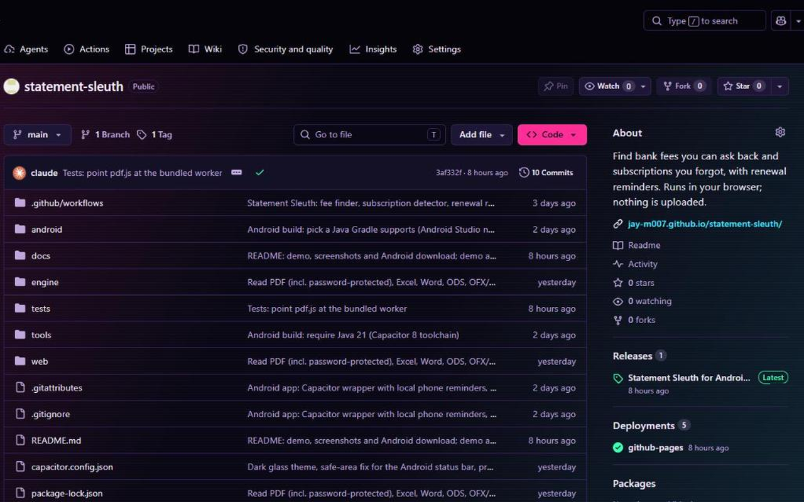
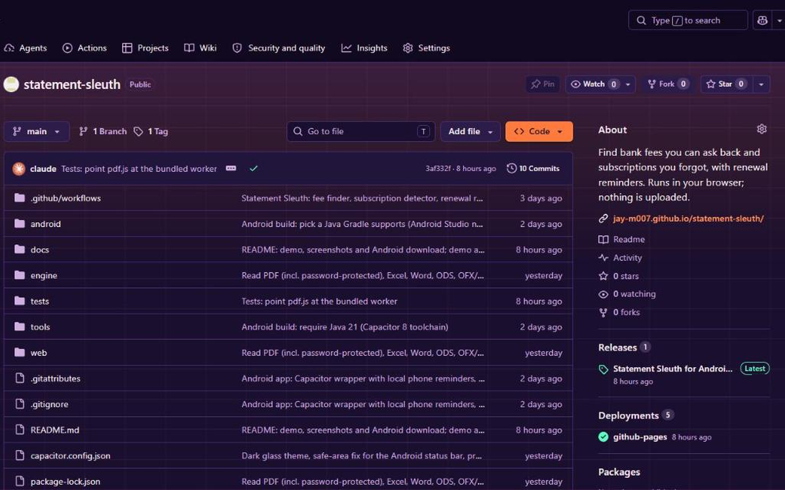
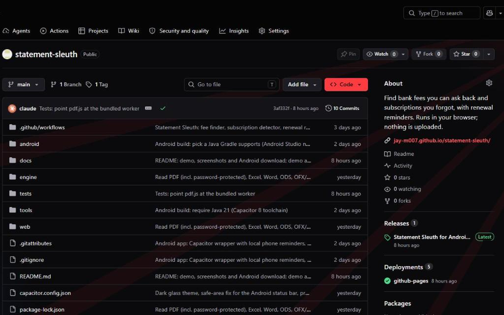
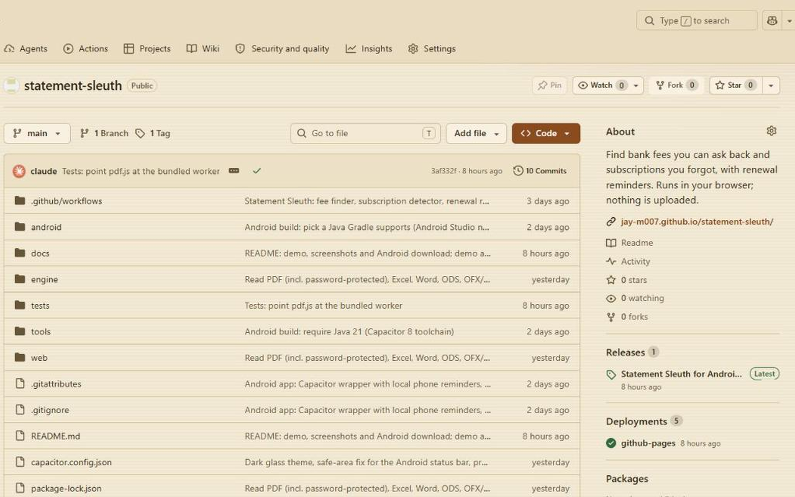
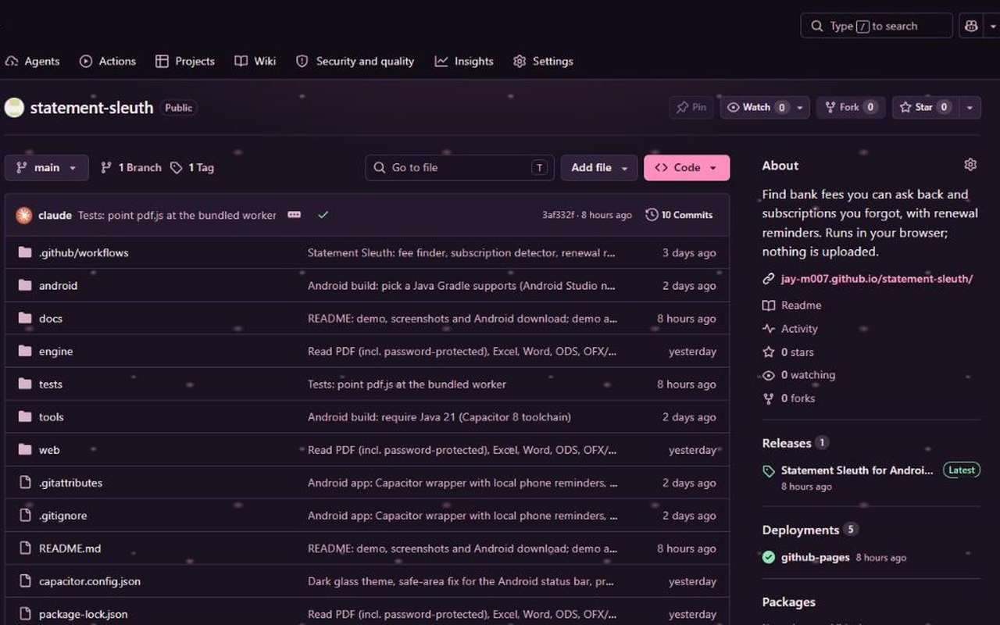

# HubSkins: Themes for GitHub

A browser extension that gives GitHub 16 hand-made themes (neon, sakura, pixel, paper, synthwave and more), including a themed contribution graph. Free, no tracking, no network requests, runs only on github.com and gist.github.com.

- Alt+Shift+T turns the theme on or off
- Alt+Shift+N jumps to the next theme
- Optional daily theme shuffle

## Themes

| | |
|---|---|
|  |  |
|  |  |
|  | |

## Install
- Firefox: under review on addons.mozilla.org
- Edge: coming soon
- From source: see below

## Load from source
1. Clone this repo.
2. Chrome / Edge: open `chrome://extensions` (or `edge://extensions`), turn on Developer mode, choose **Load unpacked** and select this folder.
3. Firefox: replace `manifest.json` with `manifest.firefox.json`, open `about:debugging`, choose **Load Temporary Add-on** and pick `manifest.json`.

## Privacy
HubSkins collects nothing. Settings stay in your browser's own storage.

Report bugs: https://github.com/jay-m007/hubskins/issues/new
